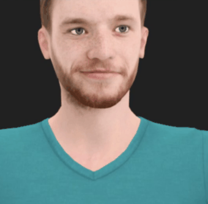

# GazeEngine

A biologically-inspired gaze coordination engine for humanoid robot heads.
Instead of "detect face → rotate toward it", this engine models how humans actually look:
eyes move fast, neck follows slowly, attention drifts naturally, and idle behavior isn't robotic.

Runs on a PC with a webcam and mirrors the result onto a Three.js VRM avatar, so you can tune
human-likeness without owning the hardware.

**中文速览**：一套给仿人机器人头部的拟人注视引擎——眼先动、脖子滞后跟随，5 种注意力模式、
8 族拟人状态（6 维情绪参数驱动微动作）、自然待机与扫视过冲。PC + 摄像头即可调参，
结果实时映射到 VRM 数字人。详见 [docs/ARCHITECTURE.md](docs/ARCHITECTURE.md)。



*Offline replay of a recorded trajectory: eyes lead, the neck lags behind. No live camera, no real person in frame.*
*Avatar: "Nova" by [VTubeMe](https://vtubeme.com/free-vrm-avatars), CC BY 4.0 — rendered here, model not redistributed.*

> **Not covered by the MIT license.** The model weights (YuNet, MediaPipe FaceLandmarker,
> ArcFace), any `.vrm` avatar and the test footage are third-party assets under their own
> terms. None of them ship in this repository — [docs/ASSETS.md](docs/ASSETS.md) lists what
> you need to fetch yourself.

## Why this exists

Most robot gaze demos look mechanical — instant lock-on, stiff tracking, no idle behavior.
This project implements:

- **Eye-neck split**: eyes take the first ~8°, neck handles the rest (like the human oculomotor system)
- **Saccadic overshoot**: small overshoot when shifting gaze between facial features
- **Attention state machine**: 5 modes (FOCUSED / LISTENING / NEUTRAL / DISTRACTED / BORED) with log-normal timing
- **Presence families**: 8 state families driven by 6 continuous dims (arousal / load / valence / intent / stability / fatigue)
- **Natural idle**: micro-movements, random pauses, no stiff "looking at nothing"
- **Departure animation**: when a person leaves, the head eases back with a slight overshoot
- **VRM mirroring**: PC-side development with a Three.js digital human, no hardware needed

## What is real, and what is scaffold

This is a research/engineering prototype, not a shippable product. The gaze behaviour itself is
fully implemented and tested; the hardware-facing ends are not.

| Part | State |
|---|---|
| `p1_perception/` (PC path) | Runs. YuNet + MediaPipe FaceLandmarker + ArcFace on webcam or video files. |
| `p2_decision/` | Runs. This is where almost all behaviour lives; covered by the unit tests. |
| `3d/` renderer + `tools/` | Runs standalone. No avatar model is shipped, by design. |
| `p3_exec/` | **Skeleton.** `actuator_backend.hpp` and `rt_loop.hpp` are interface stubs: no serial framing, no real servo bus. |
| `p1_perception/main.py` (board path) | **Mock.** RKNN model loading, depth MLP and V4L2 capture are `TODO` stubs so the pipeline can be exercised without the board. |

If you are looking for a drop-in driver for a specific head, this repo gives you the decision
layer and a place to plug your bus in — it does not give you the bus.

## Architecture

```
┌─────────────┐    ZMQ    ┌─────────────┐    WS     ┌─────────────┐
│  Camera     │ ────────→ │  P2 Decision │ ────────→ │  VRM Web    │
│  (P1 Percep)│           │  (State +    │           │  (Three.js) │
│  Face detect│           │   Geometry)  │           │  Digital    │
│  Track + ReID│          │  Attention   │           │  Human      │
└─────────────┘           └─────────────┘           └─────────────┘
                                 │
                                 ▼
                          ┌─────────────┐
                          │  P3 Exec    │
                          │  Servo bus  │
                          │  (RS485)    │
                          └─────────────┘
```

| Layer | Responsibility |
|-------|---------------|
| L0 Scheduler | Frame timing, ZMQ poll loop |
| L1 State family | FSM: LOOKING / AWAY / RETURN / SCANNING + attention modes |
| L2 Dimension | Pan / tilt / vergence / blink / roll — each independently parameterized |
| L3 Execution | Servo rate limiting, soft limits, watchdog |

## Quick start

### Prerequisites

- Python 3.10 (tested on 3.10.x; 3.11+ works for P2 but MediaPipe wheels lag)
- A webcam, or your own video files
- Node.js only for the renderer smoke test
- No internet needed for the viewer: three.js and three-vrm are vendored in `3d/vendor/`

### Install

```bash
pip install -r requirements.txt
```

### Get the model weights

Weights are **not** in this repo (size + license). See [models/README.md](models/README.md)
for the three files to download into `models/`.

### Run with a webcam

On Windows, one script starts the static server, the WebSocket bridge and the harness,
then opens the page:

```powershell
.\tools\start_all.ps1          # add -NoCam to run without a camera
```

On any OS, run the three pieces from [Manual three-terminal setup](#manual-three-terminal-setup)
below, then open `http://localhost:8898/3d/index.html`. The avatar mirrors the gaze output.

### Run with a VRM avatar

The repo ships no avatar model (third-party licenses). Drop any `.vrm` file into `3d/`
named `nova_model.vrm` — that is what the page loads by default. To use a different file:

```
http://localhost:8898/3d/index.html?model=another_avatar.vrm
```

Without a model the page still runs and shows the load error in the status bar, so you can
inspect the gaze stream with the replay viewer instead.

### Manual three-terminal setup

```bash
python -m http.server 8898          # 1. serve the repo root (3d/, tools/)
python tools/ws_bridge.py           # 2. ZMQ :5557 → WebSocket :9000
python test_harness.py --cam 0      # 3. P1 + P2 + publisher
```

`tools/start_all.ps1` does all three on Windows.

### Ports

Everything binds `127.0.0.1` only — nothing is exposed to the LAN.

| Port | Transport | Binds | Purpose |
|---|---|---|---|
| 5551 | ZMQ | P1 (`main.py`) | IF-1a: detection results → P2 |
| 5552 | ZMQ | P1 | IF-1b: reserved second channel, no consumer in this repo |
| 5553 | ZMQ | `tools/send_control.py` | Control: preset / attention-mode switching |
| 5555 | ZMQ | P2 | IF-5: joint targets → P3 |
| 5557 | ZMQ PUB | harness / P2 | Debug stream: everything the renderer needs |
| 5560 | ZMQ | P2 | Heartbeat, for an external supervisor (no subscriber here) |
| 9000 | WebSocket | `tools/ws_bridge.py` | ZMQ 5557 → browser |
| 9100 | HTTP | `tools/calib_bridge.py` | Calibration page + static files (its WS bridge is 9101) |
| 8898 | HTTP | `python -m http.server` | Static `3d/` for the manual setup |
| 8899 | HTTP | `tools/action_editor/server.py` | Action editor |
| 8000 | HTTP | `tools/start_all.ps1 -Port` | Static server used by the one-click script |

The ZMQ ports all read a `GAZE_*` environment variable (see each module); the HTTP ports are
mostly fixed — `calib_bridge --http` and `start_all.ps1 -Port` are the exceptions.

### Run tests

```bash
pytest tests -q
```

`tests/` covers FSM, geometry, invariants, calibration, presence, payload schema, random audit
and the renderer smoke: **83 cases in total**. Without the model weights, 78 pass and the 5 in
`tests/test_perception.py` are reported as **skipped** — they load YuNet and need the weights
from `models/README.md` (the file is git-ignored).

## Key parameters

All tunable in `p2_decision/config.py`:

| Parameter | Default | Effect |
|-----------|---------|--------|
| `EYE_REST_PAN_DEG` | 8.0 | Eyes take first 8° before neck engages |
| `NECK_MAX_YAW_DEG` | 35.0 | Neck pan limit |
| `OVERSHOOT_MIN/MAX` | 0.05–0.15 | Saccadic overshoot magnitude |
| `ENTER_PAN_DEG` | 5.0 | Angle threshold for eye→neck handoff |
| `RETURN_MS` | 1800 | RETURN state duration (eyes first, neck follows) |

## Attention modes

| Mode | Look duration | Away frequency | Nod | Blink |
|------|--------------|----------------|-----|-------|
| FOCUSED | ~18s | rare | ×1.5 | ×0.7 |
| LISTENING | ~25s | very rare | ×2.0 | ×0.5 |
| NEUTRAL | ~10s | occasional | ×1.0 | ×1.0 |
| DISTRACTED | ~4s | frequent | ×0.3 | ×1.3 |
| BORED | ~2.5s | very frequent | ×0.0 | ×1.5 |

Modes transition automatically with log-normal timing and negative correlation between
consecutive gazes.

## Project structure

```
├── p1_perception/          # Face detection, tracking, ReID
│   ├── pc_models.py        # YuNet + FaceLandmarker + ArcFace
│   ├── tracker.py          # IoU multi-face tracking
│   └── distance_kalman.py  # Depth estimation
├── p2_decision/            # Core gaze engine
│   ├── state_machine.py    # FSM + attention modes
│   ├── presence.py         # 8 families × 6 dims micro-motion generator
│   ├── geometry.py         # Pixel→angle, eye-neck split, overshoot
│   ├── boot_choreography.py# 17s boot sequence, 27 keyframes
│   └── config.py           # All tunable parameters
├── p3_exec/                # Hardware abstraction (servo bus, RT loop skeleton)
├── proto/                  # ZMQ message schema (protobuf)
├── 3d/                     # Three.js VRM viewer + calibration page
├── tools/                  # WS bridge, calibration wizard, action editor, perf probe
├── random_audit/           # Seeded regression audit (trajectory + thresholds)
├── tests/                  # Unit + integration tests
└── test_videos/            # Trajectory CSVs for replay (videos not included)
```

## Docs

| File | What's inside |
|---|---|
| [docs/README.md](docs/README.md) | Start here: one English line per doc, and what is stale |
| [docs/ARCHITECTURE.md](docs/ARCHITECTURE.md) | Layer-by-layer design, data flow |
| [docs/CALIBRATION_SPEC.md](docs/CALIBRATION_SPEC.md) | Calibration wizard spec and coefficients |
| [docs/BOOT_SEQUENCE.md](docs/BOOT_SEQUENCE.md) | Boot choreography timeline |
| [docs/THINKING_DESIGN.md](docs/THINKING_DESIGN.md) | Thinking/idle gaze design |
| [docs/action_architecture_design.md](docs/action_architecture_design.md) | Action layer architecture (scheduler, blink chain, family state machine) |
| [docs/IDLE_PRESET_PLAN.md](docs/IDLE_PRESET_PLAN.md) | Idle preset plan and tuning notes |
| [docs/ASSETS.md](docs/ASSETS.md) | What is deliberately not in the repo, and why |
| [proto/README.md](proto/README.md) | Message schema, port-per-link map, regeneration |

Design docs are written in Chinese; code comments are mixed. English translations are welcome.

## Roadmap

- [ ] Persistent face identity (known faces get longer gaze)
- [ ] Audio-driven attention (VAD → LISTENING mode)
- [ ] Embedded deployment (RK3576/3588 NPU)
- [ ] Real servo bus (RS485) + interpolation in `p3_exec/`
- [ ] More VRM avatar support

## Contributing

See [CONTRIBUTING.md](CONTRIBUTING.md). Issues about "it looks robotic" are welcome — include
a clip or a trajectory CSV if you can.

Security problems go through [SECURITY.md](SECURITY.md) (private advisory), not the public
issue tracker. Everyone participating is expected to follow the
[Code of Conduct](CODE_OF_CONDUCT.md).

## License

MIT. See [LICENSE](LICENSE). Third-party weights, avatars and test footage keep their own
licenses and are not distributed with this repository.

The copyright holder is recorded under the pseudonym `imotionloom`; see [NOTICE](NOTICE)
for how the author's identity is handled and disclosed. Nothing there narrows the MIT grant.
